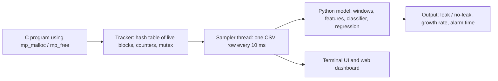
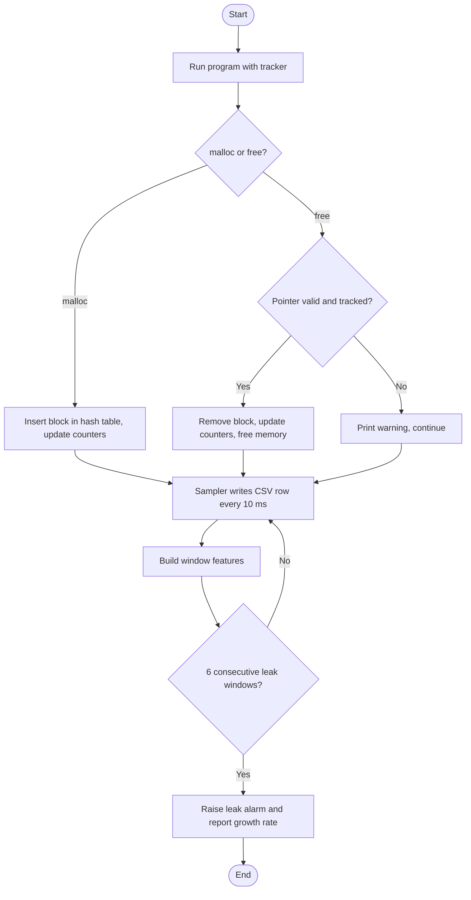

# MemPredict-C: AI-Guided Memory Leak Prediction for Long-Running C Programs

> Mini Hackathon | B.Tech CSE | UPES | Batch 10 | Team 12

A C memory tracker watches every `malloc` and `free`, logs memory statistics over time, and a small machine-learning model predicts whether the program is leaking, before it exits.

---

## 1. Team Details

| Field | Details |
|---|---|
| Team Number | 12 |
| Batch | 10 |
| Faculty | Subhranil Das |
| Program | B.Tech CSE, UPES |

| # | Name |
|---|---|
| 1 | Vansh Jain |
| 2 | Ashutosh Patra |
| 3 | Arnav Pranjal |

---

## 2. Problem Statement

A memory leak happens when a program allocates heap memory with `malloc` and loses the last pointer to it without calling `free`. In servers, daemons and embedded firmware that run for days, even a few leaked bytes per request grow into gigabytes.

Tools like Valgrind and AddressSanitizer are precise, but they report leaks **when the program exits**, which a server never does, and they slow the program down a lot (AddressSanitizer measured about 15x here).

**Goal:** build a cheap tracker that logs memory statistics while the program runs, and use a small machine-learning model to give an **early warning** that memory is growing like a leak, as opposed to a cache filling up or a burst of work.

---

## 3. Objectives and Features

**Objectives**
- Track every allocation and free in a running C program with low overhead.
- Log memory statistics over time to a CSV file.
- Predict "likely leak" or "no leak" from the shape of the memory curve and raise an alarm early.
- Report honestly how accurate it is, how early it warns, and what it costs.

**Features**
- **Tracker library** (`mp_malloc`, `mp_calloc`, `mp_realloc`, `mp_free`) records pointer, size, file, line and timestamp in a hash table with O(1) lookup.
- **Safe free:** ignores `NULL` and warns on double free or unknown pointers instead of crashing.
- **Thread-safe** through a mutex.
- **Sampler thread** writes one CSV row every 10 ms, even when the program is idle.
- **Simulated workloads:** request server, bounded cache and bursty batch, each clean or leaky.
- **Python ML:** windowed features, Decision Tree and Random Forest classifier, linear-fit growth forecast.
- **Early-warning alarm:** fires only after 6 consecutive leak windows, which cuts false alarms.
- **Size-class pool allocator** with aligned blocks and double-free detection.
- **Simple terminal report in C** (`mp_ui.c`): result (NORMAL / WATCHING / LEAK LIKELY), memory over time, growth rate and time until the memory limit.
- **Web dashboard** (`dashboard.html`): animated chart of the same analysis, runs in any browser.

---

## 4. How It Works

### Architecture



CSV columns written by the sampler: `time_s, live_bytes, live_count, alloc_rate, free_rate, avg_block_age`

The tracker itself does not use ML. The model runs offline (or in a separate process) on the log.

### Algorithm (pseudocode)

```text
TRACKER
  mp_malloc(size, file, line):
      p = malloc(size)
      if p != NULL: insert (p, size, file, line, time) into hash table
                    live_bytes += size; live_count += 1
      return p

  mp_free(p, file, line):
      if p == NULL: return
      if p not found in hash table: print warning (double or unknown free); return
      remove p from hash table; live_bytes -= size; live_count -= 1
      free(p)

SAMPLER THREAD (every 10 ms)
  lock; read live_bytes, alloc/free counters, block ages; unlock
  write one CSV row

PREDICTION
  slide a 20-sample window over the CSV
  for each window compute features:
      slope, R2 of line fit, floor slope (rolling-minimum trend),
      fraction of snapshots increasing, alloc-free rate,
      average block age, coefficient of variation, end/start ratio
  classify each window with Random Forest -> leak / no leak
  ALARM when 6 consecutive windows are classified "leak"
  growth rate = slope of the floor (lower envelope) trend
  time to limit = (limit - now) / slope
```

### Flowchart



---

## 5. C Programming Concepts Used

- Dynamic memory allocation: `malloc`, `calloc`, `realloc`, `free`, `aligned_alloc`
- Pointers, structures (`struct Node`) and chained hash buckets
- Hash table implementation keyed by pointer address
- Preprocessor macros with `__FILE__` and `__LINE__`
- File handling (`fopen`, `fgets`, `fprintf`) for CSV logging and reading
- Multithreading with `pthread` (sampler thread) and mutex locking
- Memory alignment and size classes (pool allocator)
- Timing with `clock_gettime` and `usleep`
- Dynamic arrays with `realloc`, command-line arguments (`argc`, `argv`)
- ANSI escape codes for the terminal UI, math library (`-lm`)
- Multi-file programs with a header and compiling with `gcc` flags

---

## 6. Repository Structure

> Edit file names to match your repository.

```text
Batch10_Team12_MemPredictC/
├── README.md
├── mempredict.h          # tracker API and macros
├── mempredict.c          # tracker + sampler thread
├── sim.c                 # server / cache / bursty workloads
├── pool.c                # size-class pool allocator
├── mp_ui.c               # terminal UI (reads sampler CSV or runs a demo)
├── dashboard.html        # browser dashboard
├── analyze.py            # features, classifier, regression, alarm
├── tests/
│   ├── test_ok.c         # leaks 200 bytes, then reports
│   ├── test_null.c       # free(NULL)
│   └── test_safe.c       # double free
├── data/                 # generated CSV logs
├── presentation.pptx
├── flowchart.png
└── screenshots/
    └── sample_output.png
```

---

## 7. How to Compile and Run

**Requirements:** GCC on Linux, WSL or macOS. For the ML part: Python 3.9+ with `pandas`, `numpy`, `scipy`, `scikit-learn`.

### Tracker and tests
```bash
gcc -Wall -Wextra -O2 -pthread tests/test_ok.c mempredict.c -o test_ok
gcc -Wall -Wextra -O2 -pthread tests/test_safe.c mempredict.c -o test_safe
gcc -Wall -Wextra -O2 -pthread tests/test_null.c mempredict.c -o test_null
./test_ok && ./test_safe && ./test_null
```

### Simulator (generates CSV logs)
```bash
gcc -Wall -Wextra -O2 -pthread sim.c mempredict.c -o sim
./sim 0 5 42 500      # args: workload (0 server, 1 cache, 2 bursty), leak per-mille, seed, duration ms
```
> Check these arguments against your `sim.c`.

### ML analysis
```bash
pip install pandas numpy scipy scikit-learn
python3 analyze.py data/
```

### Terminal UI
```bash
gcc -Wall -Wextra -O2 mp_ui.c -o mp_ui -lm

./mp_ui data/run_leaky.csv                  # read a sampler CSV
./mp_ui --demo server --leak 8 --seed 42    # built-in demo, leaky server
./mp_ui --demo cache --leak 0               # clean cache
./mp_ui --demo bursty --leak 8 --limit 512  # bursty, 512 MB limit
```
Options: `--limit MB`, `--live` (animate), `--speed ms`, `--no-color`. The output is plain ASCII, so it looks the same on every terminal.

### Web dashboard
Open `dashboard.html` in any browser (no install). Pick a workload, set the leak rate and press **Run simulation**, or press **Load sampler CSV** to analyse your own log.

> The terminal UI and dashboard use a transparent rule on the window features so they run with no libraries. The Random Forest lives in `analyze.py`.

---

## 8. Sample Test Cases

The **Actual Output** column for the C tests must be filled from your own run. Paste the real terminal text and save a screenshot to `screenshots/`.

### C tracker tests

| # | Test case | Action | Expected output | Actual output | Pass? |
|---|---|---|---|---|---|
| 1 | Normal leak report | Allocate blocks, free some, leave 200 bytes unfreed | `LEAK: 200 bytes` with file and line, plus total leaked | _[paste]_ | |
| 2 | All memory freed | Allocate and free every block | Total leaked: 0 bytes | _[paste]_ | |
| 3 | `free(NULL)` | Call `mp_free(NULL)` | No crash, no warning (legal in C) | _[paste]_ | |
| 4 | Double free | Free the same pointer twice | Warning printed, program continues, no segfault | _[paste]_ | |
| 5 | Unknown pointer | Free a pointer never allocated by `mp_malloc` | Warning printed, program continues | _[paste]_ | |
| 6 | `realloc` tracking | Grow a block with `mp_realloc` | Old pointer untracked, new one tracked, `live_bytes` correct | _[paste]_ | |

### Terminal UI tests (real outputs from our runs)

| # | Command | Expected | Actual output | Pass? |
|---|---|---|---|---|
| 7 | `./mp_ui --demo server --leak 8 --seed 42` | Alarm raised, growth forecast shown | `LEAK LIKELY`, alarm at 1.59 s, growing 117.9 KB per second, 35.7 minutes to 256 MB | Yes |
| 8 | `./mp_ui --demo cache --leak 0` | No alarm (cache fills, then flattens) | `NORMAL`, memory is steady | Yes |
| 9 | `./mp_ui --demo bursty --leak 0` | No alarm despite bursts | `NORMAL`, memory is steady | Yes |
| 10 | `./mp_ui leaky.csv` (synthetic steady growth) | Alarm raised | `LEAK LIKELY`, alarm at 1.44 s, growing 250.1 KB per second | Yes |

Sample screen from test 7:

```text
=============================================
  MemPredict-C : Memory Leak Check
=============================================
  Result : LEAK LIKELY
  Why    : memory kept growing in 6 checks in a row
  Alarm  : raised at 1.59 s (32% of the run)
---------------------------------------------
  Memory over time
   0.0 s |#                             | 151.2 KB
   1.0 s |##########################    | 3.13 MB
   2.0 s |###########################   | 3.24 MB
   3.0 s |############################  | 3.36 MB
   4.0 s |############################# | 3.49 MB
   5.0 s |##############################| 3.60 MB
---------------------------------------------
  Memory now : 3.60 MB
  Growing by : 117.9 KB every second
  Will reach 256 MB in about 35.7 minutes
=============================================
```

### Measured results from our experiments

Simulated programs, 500 ms runs, 5-fold cross-validation split by run.

| Metric | Result |
|---|---|
| Random Forest accuracy (grouped CV) | 83.1% (precision 84.4%, recall 81.6%) |
| Accuracy by workload | server 98.5%, cache 87.6%, bursty 63.3% |
| Alarm at k = 6 | 89% of leaky runs caught, 13.5% of clean runs falsely flagged |
| Median alarm time | 244 ms of a 500 ms run |
| Free time, 50k blocks | 4,697 ms (linked list) to 0.9 ms (hash table) |
| Overhead per alloc+free | malloc 26 ns, tracker 105 ns (4x), AddressSanitizer 385 ns (15x) |

---

## 9. Limitations and Future Work

**Limitations**
- Trained on simulated programs; real applications may behave differently.
- Runs are only 500 ms on a single core, and small leaks in bursty programs are not reliably detected (63%).
- Growth-rate regression works only on steady workloads (r = 0.91 server, 0.13 cache, 0.30 bursty).
- The model predicts a *likely* leak and cannot prove one.
- The pool allocator is not faster than glibc malloc (41 ns vs 34 ns).
- The tracker adds about 4x per-call overhead.

**Future work**
- Test on real open-source servers and longer runs.
- Per-call-site growth (`file:line`) to point at the leaking code.
- Online prediction inside the process with a tiny model.
- Confirm alarms with LeakSanitizer reports.
- Thread-local caches in the pool allocator.

---

## 10. AI-Assisted Development

We built the project in five prompt, code, run, flaw, fix iterations. Each AI draft compiled and looked right, but running it exposed a real flaw (a segfault, a quadratic slowdown, missing data rows, a trivially easy dataset, an unfair train/test split, misaligned memory). Lesson: AI speeds up the draft, while measurement, sanitizers and benchmarks make it correct.

---

## 11. References

- Valgrind: https://valgrind.org
- AddressSanitizer / LeakSanitizer: GCC and Clang documentation
- Pedregosa et al., *scikit-learn: Machine Learning in Python*, JMLR 12, 2011
- Python, pandas, NumPy, SciPy
